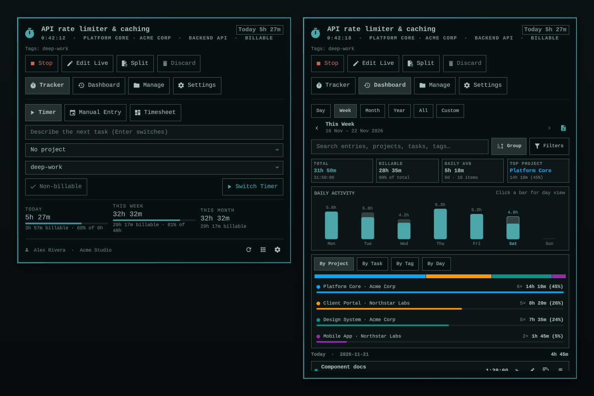

# Clockify for Omarchy

A full-featured [Clockify](https://clockify.me) time tracker, analytics dashboard, and workspace controller for the [Omarchy](https://omarchy.org) bar.

<p align="center"></p>

## What it does

- **Live bar pill.** Shows the Clockify icon dimmed when idle, or live `H:MM:SS` elapsed time (and optional active task label) while a timer runs. Hover for task, project, elapsed time, today's total, and this week's total. Left-click opens the panel, right-click toggles start/stop, middle-click refreshes.
- **Zero-config Desktop Session Auto-Sync + API Key fallback.** Automatically reads and refreshes your logged-in Clockify Desktop session (`~/.config/Clockify/Local Storage/leveldb/`), or accepts a personal API key stored with `0600` permissions in `~/.config/omarchy/clockify.json`, `$CLOCKIFY_API_KEY`, or `~/.config/clockify-cli/config.yaml`.
- **Full Timer & Running Entry Control.** Start, switch, stop, or discard timers. Live-edit the currently running entry's description, project, task, tags, billability, start `HH:MM`, or `-5m` / `+5m` offsets without stopping it.
- **Manual Time Entry & Quick Resume.** Switch between live Timer mode and Manual Entry mode (`today`, `yesterday`, or `YYYY-MM-DD` with start/end `HH:MM`), or click recent entry chips to prefill your next entry.
- **Interactive Analytics Dashboard.** Browse `Day`, `Week`, `Month`, `Year`, `All`, or `Custom` date ranges with `‹` / `›` period stepping, 4 KPI cards (Total, Billable %, Daily Average, Top Project), an interactive hourly/daily/monthly activity bar chart (click any day bar to drill into that day), a stacked distribution bar and clickable breakdown (`By Project`, `By Task`, `By Tag`, `By Day`), multi-filter controls (Project, Task, Tag, Billable status, Search text), date-grouped entry rows (`Continue`, `Edit`, `Duplicate`, `Delete`), and one-click CSV export to `~/Downloads/`.
- **Workspace & Resource Management.** Create new **Projects** (with client, color swatch, billable/public flags), **Tasks**, **Tags**, and **Clients** directly from the Manage tab, and switch between Clockify **Workspaces**.
- **Pomodoro & Idle Automation.** Built-in Pomodoro focus/break cycle with desktop notifications (automatically stops the timer on break) plus optional idle reminder notifications and auto-stop limits for forgotten timers.

## Install

```bash
omarchy plugin add https://github.com/AbdulrahmanHR/omarchy-clockify --enable
```

Requires only `python3` (shipped with Omarchy) — no external Python packages or background daemons, and runs entirely in user space.

For terminal CLI access outside the bar, you can optionally symlink `clockify.py`:

```bash
ln -sf ~/.config/omarchy/plugins/io.github.abdulrahmanhr.clockify/clockify.py ~/.local/bin/clockify-ctl
```

### Updating

```bash
omarchy plugin update io.github.abdulrahmanhr.clockify
omarchy restart shell
```

## Authentication

1. **Clockify Desktop app (automatic):** If you are signed into Clockify Desktop, the plugin discovers and refreshes your token automatically on first refresh.
2. **Personal API Key:** Open the panel and paste your API key from Clockify → **Preferences → Advanced → API** (stored in `~/.config/omarchy/clockify.json` with `0600` permissions), or set `$CLOCKIFY_API_KEY`.

## Widget Settings

Configurable in the bar settings panel or under the widget entry in `~/.config/omarchy/shell.json`:

| Key | Default | Description |
| --- | --- | --- |
| `refreshIntervalSec` | `45` | Background polling interval in seconds (`15`–`3600`) |
| `hideWhenIdle` | `false` | Hide the bar pill when no timer is running |
| `showTimerInBar` | `true` | Show live `H:MM:SS` beside the icon while timing |
| `showTaskInBar` | `false` | Include the active task/description in the bar pill |

## Shell IPC & CLI

```bash
omarchy-shell io.github.abdulrahmanhr.clockify toggle
omarchy-shell io.github.abdulrahmanhr.clockify toggleTimer
omarchy-shell io.github.abdulrahmanhr.clockify startTimer "Write docs" ""
omarchy-shell io.github.abdulrahmanhr.clockify stopTimer
omarchy-shell io.github.abdulrahmanhr.clockify discardTimer
omarchy-shell io.github.abdulrahmanhr.clockify status
omarchy-shell io.github.abdulrahmanhr.clockify debug
```

Direct CLI usage:

```bash
./clockify.py status --full | jq
./clockify.py start --description "Deep work" --project <project-id> --task <task-id> --billable
./clockify.py update-running --adjust-minutes 5
./clockify.py add-manual --date today --start 09:00 --end 10:30 --description "Planning"
./clockify.py export-csv --start-date 2026-11-01 --end-date 2026-11-30
```

## Tests

```bash
python3 -m unittest discover -s test -v
omarchy plugin validate .
```

## Remove

```bash
omarchy plugin disable io.github.abdulrahmanhr.clockify
omarchy plugin remove io.github.abdulrahmanhr.clockify
rm -f ~/.config/omarchy/clockify.json ~/.local/bin/clockify-ctl
```

## License

MIT — see [`LICENSE`](LICENSE).
